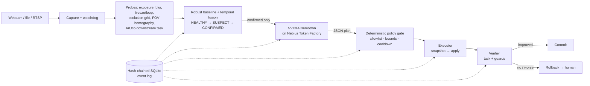

# Physical AI Reliability Agent

**An autonomous reliability layer for camera-based Physical AI.** It watches a camera, notices
when the perception pipeline stops being trustworthy, asks **NVIDIA Nemotron on Nebius Token
Factory** for a root-cause diagnosis and a plan, runs only **bounded, reversible** fixes through a
deterministic policy gate, and **keeps the change only if the downstream task measurably
recovers** — otherwise it rolls back and escalates to a human.

> Working name · Nebius x NVIDIA Global AI Hackathon 2026 · **Physical AI track** ·
> License: [Apache-2.0](LICENSE) · Evidence exists for F3, F5, F6, F7, and F8; F4
> real-hardware benchmarking and F9 product review remain open. F10 is pending PR #58 integration;
> F11 is pending review. Evidence is labelled SIMULATION or REAL HARDWARE.
> See [`docs/phases-and-gates.md`](docs/phases-and-gates.md).

## Why

A camera can be "online" and useless: defocused, covered, too dark, frozen on the last frame,
knocked out of position. Commercial camera-health tools already raise alerts for this. What is
missing for robots and edge AI is the **closed loop**:

```
detect → diagnose (Nemotron) → act safely → verify on the downstream task → commit or roll back
```

Verifying on the *task* matters: we measured that ArUco marker detection on our synthetic scene
fails at mild blur but succeeds again at stronger blur — image-quality metrics alone are not a
safe success criterion (consistent with Wischow et al., arXiv:2112.05456).

## How it works (MAPE-K)



| Stage | Module | Authority |
|---|---|---|
| Monitor | `capture/`, `probes/`, `tasks/marker.py` | local, deterministic, works offline |
| Analyze | `baselines/robust.py`, `incidents/fusion.py`, `incidents/state_machine.py` | deterministic |
| Plan | `nemotron/` | **advisory only** — Nemotron proposes, never executes |
| Execute | `policy/gate.py`, `actions/executor.py` | allowlist, typed bounds, cooldown, rate limit |
| Verify | `verification/verifier.py` | commit/rollback rule |
| Knowledge | `storage/event_store.py` | append-only, tamper-evident |

Non-negotiables: detection works without the cloud · Nemotron is called only after a CONFIRMED
incident · the LLM never touches the device · every action has a snapshot, timeout and rollback ·
client-side budget caps · a Token Factory outage degrades to local rules + human escalation.

## How we use NVIDIA and Nebius

- **NVIDIA Nemotron 3** (open models) via **Nebius Token Factory**'s OpenAI-compatible API
  (`https://api.tokenfactory.nebius.com/v1/`) for causal diagnosis, action selection among the
  incident's allowed actions, verification design and a human-readable explanation.
- The deterministic policy gate offers only fault-relevant, device-supported actions plus safe
  escalation (ADR-009); Nemotron proposes but never executes. A circuit breaker and local-rule
  fallback keep monitoring available during provider outages.
- Each call logs model, prompt version, input/output tokens, latency and estimated cost. The live
  F6 golden-set evaluation used 264 rows and cost $0.03057240
  ([report](docs/evidence/f6/golden-diagnose-v2-nvidia-nvidia-nemotron-3-nano-30b-a3b-test.md)).
  A local selector also scored 100% by action name on that test, so this is constrained action
  selection—not independent diagnosis ([baseline](docs/evidence/f6/golden-rules-baseline-test.md)).
- Tiers (ADR-002): a fast Nemotron (Nano / 3.5 Lightning) for every incident; Nemotron 3 Super
  only on ambiguity. Model IDs are **verified against `/v1/models`** (`scripts/list_models.py`),
  never trusted from docs.
- Structured output with `response_format: json_schema` where the action enum is restricted to
  the actions the policy gate offers for this device; automatic fallback to JSON mode.
- Token Factory accelerated the workflow by returning structured, auditable plans for evaluation;
  local diagnosis, gate, executor and verification remain authoritative. See
  [ADR-009](docs/adr/ADR-009-offer-only-fault-relevant-actions.md).

## Results

| Phase | Result | Evidence |
|---|---|---|
| F3 · REAL HARDWARE CPU, synthetic frames | 720p paced probe p95 was 23.2 / 32.6 / 34.5 ms on the owner's laptop under Best performance; this is CPU timing, not a live-camera latency result. | [`latency-hardware.md`](docs/evidence/f3/latency-hardware.md) |
| F3 · REAL HARDWARE camera inputs | Static-scene checks passed on the webcam and two phone RTSP scenes; the walk-by run observed 22/22 trials with no `fov_shift` window and detected its bump control. MJPEG was inconclusive. | [`static-scene-hardware.md`](docs/evidence/f3/static-scene-hardware.md), [`walkby-hardware.md`](docs/evidence/f3/walkby-hardware.md) |
| F5 · SIMULATION | Independent gate review passed 6/6 conditions; hysteresis evidence is synthetic. | [`phases-and-gates.md`](docs/phases-and-gates.md), [`hysteresis.md`](docs/evidence/f5/hysteresis.md) |
| F6 · REAL TOKEN FACTORY | Golden-v2 test: 100% schema-valid, 98.864% action accuracy, $0.03057240 run cost. The local selector also scores 100% by action name, so the score is not evidence of independent diagnosis. | [test report](docs/evidence/f6/golden-diagnose-v2-nvidia-nvidia-nemotron-3-nano-30b-a3b-test.md), [rules baseline](docs/evidence/f6/golden-rules-baseline-test.md) |
| F7 · SIMULATION | A subprocess crash-recovery test exercises restart recovery after persisted action state and verifies conservative rollback/escalation. | [`test_crash_recovery.py`](tests/integration/test_crash_recovery.py) |
| F8 · SIMULATION | Recovered 87/100 recoverable incidents. Regression results were 45/50 raw, with all 45/45 executed cases contained; five dark:0.8 cases did not execute because no incident was confirmed. | [`recovery-bench.md`](docs/evidence/f8/recovery-bench.md) |
| F10 | **Pending** PR #58 integration; the A1–A8 report is not on `main` yet. | PR #58 |
| F10 soak | **Pending**; no soak report is present on `main`. | — |

These results do not claim that the submission video, five-user test, final tag or Devpost
submission exist. F3, F5, F7 and F8 rows above are simulation or hardware measurements only as
labelled; the F6 row is a live Token Factory evaluation, not a physical-hardware run.

## Quickstart

Use a Python version supported by [`pyproject.toml`](pyproject.toml). Works on Windows and Linux;
no GPU is needed for the MVP.

```bash
git clone https://github.com/aiambo08/nebiusxnvidia_hackathon.git
cd nebiusxnvidia_hackathon
python -m venv .venv
# Windows: .venv\Scripts\activate    Linux/macOS: source .venv/bin/activate
pip install -e ".[dev,api]"

pytest -q                              # exact count: docs/evidence/f12/quickstart.md
ra-demo all                            # deterministic SIMULATION of every scenario
```

Start the read-only simulation dashboard with `ra-demo dashboard` and open
`http://127.0.0.1:8000/`; stop it with Ctrl+C. For a webcam, use
`ra-demo dashboard --live --uri 0`. See `ra-demo dashboard --help` for available options.
The static page is [`apps/dashboard/index.html`](apps/dashboard/index.html). No screenshot is
currently committed, so none is shown here.

Use Nemotron (spends a few cents of Token Factory credits):

```bash
cp .env.example .env                   # then set NEBIUS_API_KEY in .env (never commit it)
python scripts/list_models.py          # confirm NVIDIA model IDs available to your key
python scripts/spike_nemotron.py --n 20
ra-demo scenario dark --planner nemotron
```

Real camera (physical demo path):

```bash
ra-demo live --uri 0                   # REAL HARDWARE when URI 0 is a webcam
ra-demo dashboard --live --uri 0       # read-only dashboard plus live webcam agent
uvicorn --factory apps.api.main:create_app --port 8000   # read-only incident API
```

Without `NEBIUS_API_KEY` the agent starts in **local mode** (rule-based planner) and says so.

## Simulation scenarios

`ra-demo all` runs these on a seeded synthetic scene with a reference ArUco marker:

| Scenario | Expected loop |
|---|---|
| `dark` | blackout → raise exposure (bounded) → task recovers → **commit** |
| `defocus` | focus drift → autofocus → task recovers → **commit** |
| `freeze` | bit-exact repeated frames → restart capture → **commit** |
| `frozen_black` | decoder frozen on a black frame (reported as blackout) → restart capture → **commit** |
| `overexposure` | clipping → lower exposure → **commit** |
| `occlusion` | covered lens → maintenance **ticket** → waits for human → closes when clean |
| `bad_action` | a deliberately harmful plan → verification fails → **exact rollback** → human |

These are labelled SIMULATION everywhere. The hackathon video uses the real webcam.

## Repository map

```
src/reliability_agent/   capture · probes · tasks · baselines · incidents · nemotron
                         policy · actions · verification · storage · orchestrator · cli
apps/api/                read-only FastAPI over the event log (dashboard backend)
benchmarks/              seeded fault injectors, run manifests, degraded-clip builder
scripts/                 spikes/benchmarks: list_models, spike_nemotron, spike_capture, spike_static_scene, spike_walkby, bench_probes, bench_static_scene
configs/default.yaml     every threshold, cap and model ID (no secrets)
docs/                    phase gates, compliance matrix, ADRs, safety, evaluation, budget
docs/es/                 full technical execution report (Spanish)
AGENTS.md                operating manual for the multi-agent coding team
```

## Budget: zero extra spend

Only Token Factory inference is paid, from the hackathon credits. Client-side soft, demo and hard
caps, per-incident call limits, caching and the no-video-upload policy are documented in
[`docs/budget.md`](docs/budget.md).

## Out of scope (frozen at F0)

Free-form robot control or dangerous actuators · automatic physical lens cleaning · training a
foundation model · managing thousands of cameras · replacing an NVR (Frigate, Shinobi, Agent DVR)
· continuous video to Token Factory · irreversible changes decided by the LLM.

## Known limitations (honest status)

- F4 REAL HARDWARE recall/precision and varied-session benchmarking remain pending
  ([evaluation protocol](docs/evaluation.md)).
- The integrated webcam's UVC exposure/autofocus set-and-read-back has not been verified; the
  owner must run that check ([open task](docs/agents/TASKS.md)).
- The F6 action score is not an independent-diagnosis measure: the local selector also scores
  100% by action name ([F6 report](docs/evidence/f6/golden-diagnose-v2-nvidia-nvidia-nemotron-3-nano-30b-a3b-test.md),
  [baseline](docs/evidence/f6/golden-rules-baseline-test.md)).
- The pending F10 report records a 0-vs-0 COMMITTED result for the full-loop and no-downstream-metric
  arms; it does not demonstrate a difference. It is in PR #58 at
  `docs/evidence/f10/experiments.md`, pending integration.
- Freeze is checked only on the confirming window; onset can be missed due to timing. Frozen
  overexposure/focus-drift cases remain outside the blackout-only shortcut
  ([project state](docs/agents/PROJECT_STATE.md)).
- F10 soak and hardware evidence remain pending. Do not interpret simulation evidence as REAL
  HARDWARE.

## Documentation

[Phase gates](docs/phases-and-gates.md) · [Compliance matrix](docs/compliance-matrix.md) ·
[ADR-001](docs/adr/ADR-001-architecture.md) · [ADR-002](docs/adr/ADR-002-model-selection.md) ·
[Safety model](docs/safety-model.md) · [Evaluation](docs/evaluation.md) ·
[Budget](docs/budget.md) · [Research](docs/research.md) · [Feedback log](docs/feedback.md) ·
[Demo script](docs/demo-script.md) · [Devpost draft](docs/devpost.md) ·
[Owner's submission steps (ES)](docs/es/pasos-del-propietario.md) ·
[Informe técnico (ES)](docs/es/informe-tecnico-ejecucion.md)

## Hackathon notes

Created during the submission period (first commit: October 2026); not a pre-existing project.
Built with AI coding assistants under the human author's direction; design decisions are
recorded in `docs/agents/DECISIONS.md` and `docs/adr/`.

## License

Apache License 2.0 — see [LICENSE](LICENSE) and [NOTICE](NOTICE).
